# lorem-warped — PyTorch image transformations

`lorem-warped` makes controlled distortions of text-page images for visual examples and experiments. It includes local droplet warps, page-wide geometric fields, a two-view refractive-slab model, a Python callback for custom fields, a CLI, example scripts, and an illustrated manual. Install the `lorem-warped` distribution; import `lorem_warped` in Python (identifiers cannot contain hyphens) or run the installed `lorem-warped` command. The implementation is in `src/lorem_warped/`, scripts in `examples/`, documentation and figure generation in `docs/`, and checks in `tests/`.

1. **Droplets** move pixels around one or more circular centres.
2. **Page warps** move text with smooth waves, a sine lens, or a gentle pinch.
3. **Refractive index** combines two translated polarization views through a uniform anisotropic slab.

All three accept a CHW PyTorch tensor (channels, height, width). The input is converted to float values in `[0, 1]`. The output is a float CHW tensor on the input device. The CLI writes an RGB PNG. The repository includes `original.png` for your first run. The CLI uses a generated Lorem ipsum page if you do not pass `--input`.

## Distortion overview

A distortion changes where the program reads source pixels. This comparison uses the same text crop on both sides. The left panel is unwarped text with the actual square-grid droplet regions shaded gray at 30% opacity. The second panel applies a **dense square grid of droplet centres** to the page, not a grid drawn over it. With the bundled `original.png`, it requests 392 centres, radius 70 pixels, and intensity 0.5 pixels to keep the dense comparison legible. The gray guide is added only to the displayed original, not the transform input or output. All droplet warps shown here use no more than 5 px intensity.

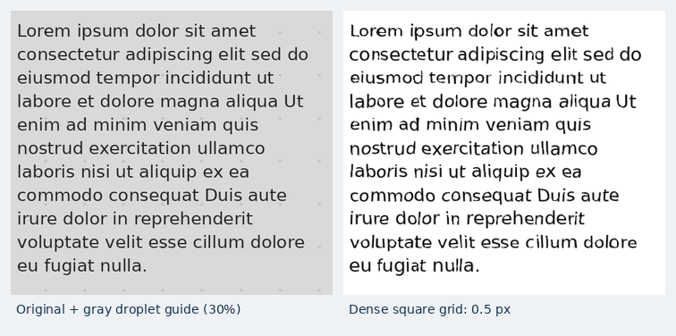

Choose the effect before you set its controls:

| Effect | Changes | Main controls |
| --- | --- | --- |
| Droplets | Local circular regions | Distribution (`random`, `square`, `triangle`), centre count, radius, intensity, seed, profile |
| Sine lens and other page warps | Larger regions of the page | Mode, pixel intensity; the sine lens also has six shape parameters |
| Refractive index | Two translated polarization views | Slab thickness (mm), indices, direction, polarization, physical page dimensions |

Distribution applies only to droplets. The three options are random, square, and triangle (hexagonal). The CLI name for the hexagonal arrangement is `triangle`, not `hex`. The [droplet distribution chapter](#droplet-distribution) compares all three layouts.

### Distortion-type index

These small previews use a distorted but still legible paragraph. The random, square, and triangular droplet-layout previews use 3 px intensity. In the PDF's “Distortion types” table, a middle column shows each same transform applied to a dense, text-free square grid; the grid bends or translates with the distortion. Open the linked chapter or mode below for its controls and larger comparisons.

- **Droplets** — circular, local displacement ([mechanics and distributions](#droplet-distribution))
  - `random` — seeded scattered centres  
    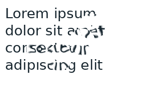
  - `square` — aligned rows and columns  
    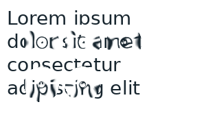
  - `triangle` — staggered triangular lattice  
    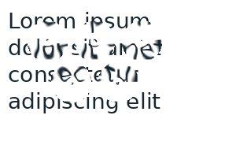
- **Page-wide fields** ([mode explanations](#public-api-and-other-modes))
  - `horizontal_wave` — left/right bands  
    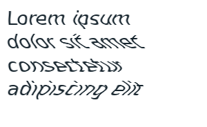
  - `vertical_wave` — up/down baseline bends  
    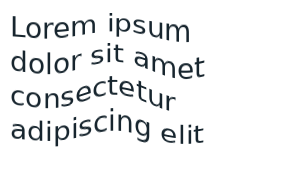
  - `sine_lens` — cell-like lens field  
    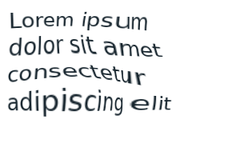
  - `gentle_pinch` — tapered inward movement  
    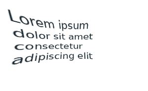
- **Uniform slab** — `refractive_index`, two constant-offset views, not a spatial warp ([physical controls](#c-refractive-index-transformation))  
  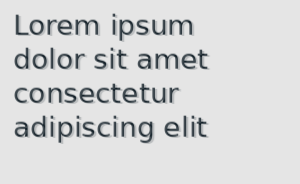
- **Python only** — `custom`, your own `(dy, dx)` field ([callback example](#custom-warp-python-only))  
  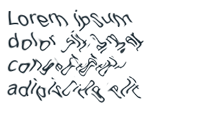


## 1. Download and install

You need Python 3.10 or later. Run these commands from a terminal:

### CLI

```bash
git clone https://github.com/Arghantyr/lorem-warped.git
cd lorem-warped
python -m venv .venv
```

Activate the environment:

- Linux/macOS: `source .venv/bin/activate`
- Windows PowerShell: `.venv\Scripts\Activate.ps1`
- Windows Command Prompt: `.venv\Scripts\activate.bat`

Install the project and run a smoke check:

### CLI

```bash
python -m pip install -e .
python -m lorem_warped --help
```

The project requires PyTorch, NumPy, and Pillow. If you need a particular CUDA or ROCm build, use the [official PyTorch install selector](https://pytorch.org/get-started/locally/) to install it in this environment before you install the project. The CLI loads images on CPU. To use a GPU in Python, move your tensor to that device before you call a transform. A virtual environment avoids changes to your system Python.

If `pip` is not available, `uv venv .venv` followed by `uv pip install --python .venv/bin/python -e .` is an alternative on Linux/macOS. Use `uv pip install --python .venv/Scripts/python.exe -e .` on Windows.

## 2. Make three images with the CLI

Each command starts from `original.png` and writes one independent output. Run the commands in the repository root. Do not reuse the same `--output` name unless you intend to replace the file.
In the droplet 2×3 gallery, the original shows actual droplet regions in gray at 30% opacity. In every non-droplet comparison, the original instead has a dense, straight square grid; the same transform warps that grid with the text in each output. These are visual guides. The CLI and Python recipes still transform the plain `original.png` unless you request a grid.

### A. Droplet transformation

#### CLI

```bash
python -m lorem_warped --input original.png --output droplet.png \
  --centres 3 --distribution random --radius 80 --intensity 5 \
  --seed 7 --profile cosine
```

`--centres` requests the number of droplet centres. `--distribution` selects `random`, `square` (aligned grid), or `triangle` (staggered, hexagonal pattern). `--radius` is in pixels. `--intensity` is the pixel displacement multiplier. `--seed` makes random centres repeatable; it does not change a regular grid. `--profile parabolic` requires disjoint droplet regions; use `--nonoverlapping-page` to request page-wide disjoint centres, or keep the default `cosine` profile for overlaps. A parabolic run with overlapping centres reports an error. See the [distribution chapter](#droplet-distribution) for a controlled comparison and both interfaces.

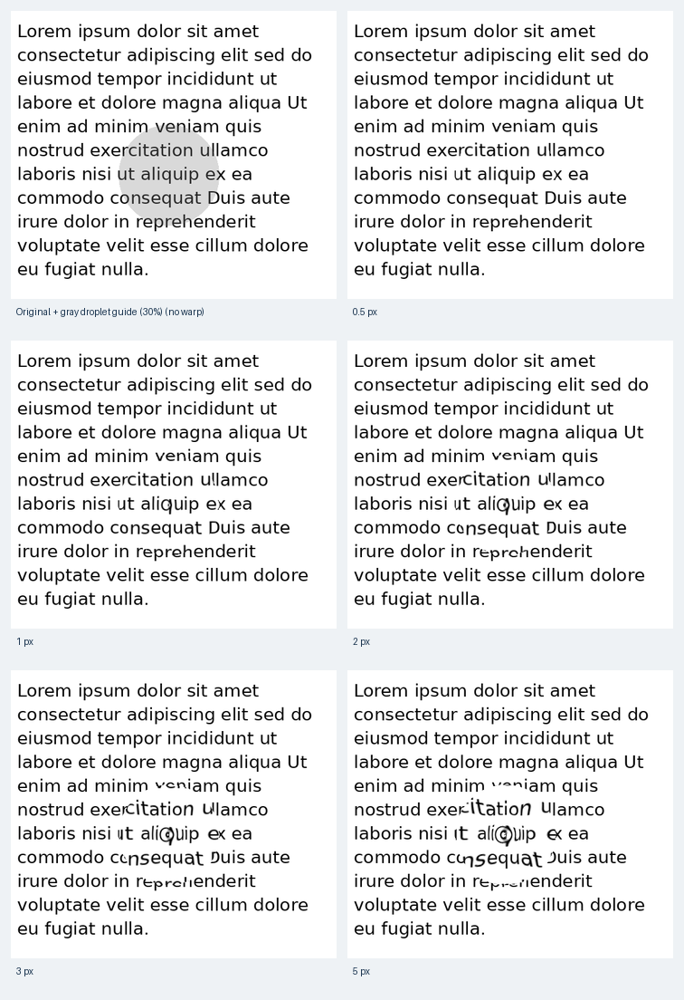

### B. Six-parameter sine-lens transformation

#### CLI

```bash
python -m lorem_warped --input original.png --output sine_lens.png \
  --page-warp sine_lens --intensity 32 \
  --lens-frequency-x 2.5 --lens-frequency-y 1.5 \
  --lens-phase-x 0.1 --lens-phase-y 0.2 \
  --lens-amplitude-x 1.2 --lens-amplitude-y 0.8
```

The six lens controls are X/Y frequency, X/Y phase, and X/Y amplitude. Frequency is positive and dimensionless; phase is a fraction of a full cycle (0.25 is a quarter-cycle); amplitude is a signed, dimensionless gain. `--intensity` is a seventh, independent setting in pixels: change it to make a strength sweep without changing the shape. The older positive integer `--lens-a` and `--lens-b` set X and Y cell counts (both default to 2); an explicit frequency for an axis overrides its count. Fractional frequencies or nonzero phases taper the field at the outer page edges.

The function diagram shows displacement vectors on a square sampling grid. X/Y gains and frequencies shape its cells; pixel intensity scales their displacement. The 4×4 study compares X frequency with pixel intensity. The reference-grid figure overlays the warped grid on the output; the grid does not generate the warp.

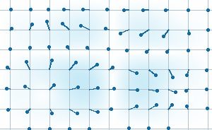
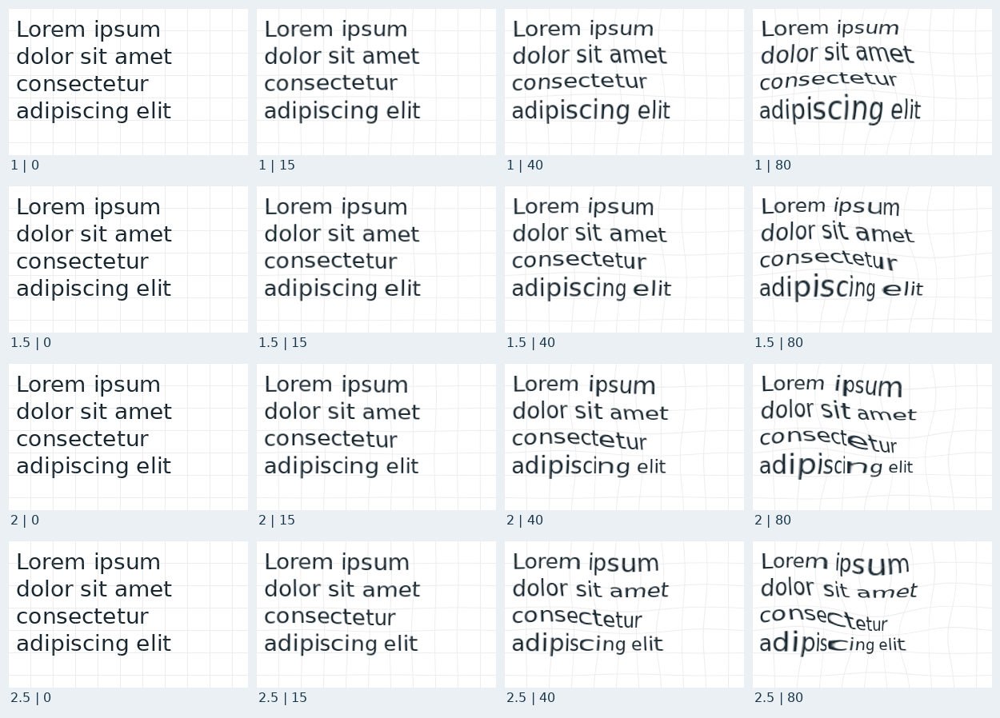


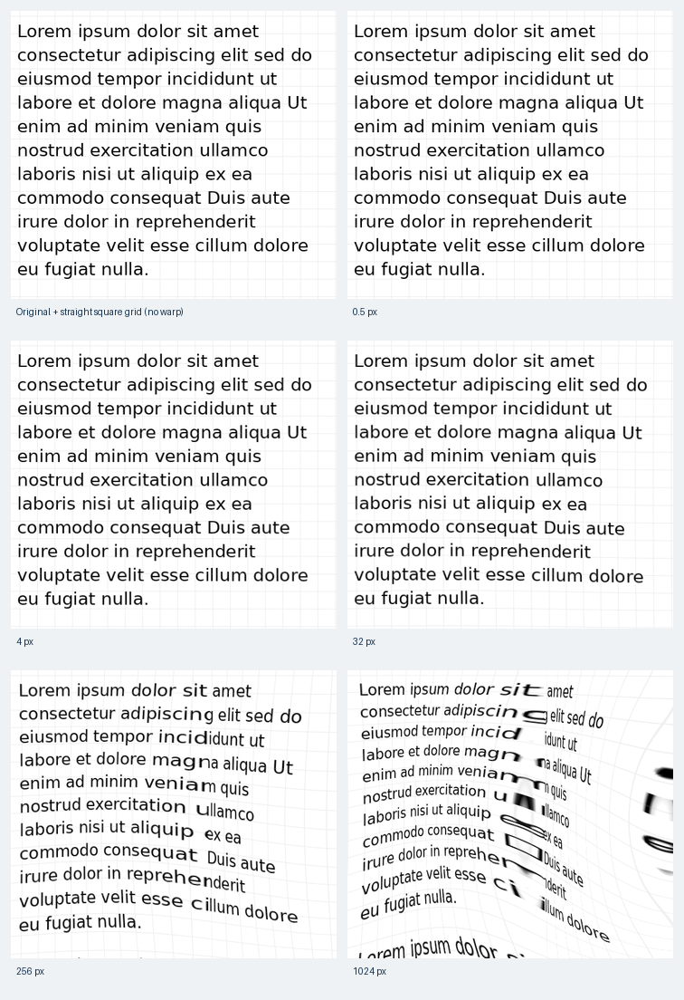

To show the same warped grid as the image, add `--show-grid --grid-spacing 40`. Add `--show-original-grid reference.png` to save an unwarped reference grid; it must have a different path from `--output`.


### C. Refractive-index transformation

#### CLI

```bash
python -m lorem_warped --input original.png --output refraction.png \
  --page-warp refractive_index --refraction-thickness-mm 5 \
  --refraction-n-x 1.3 --refraction-n-y 2.5 --refraction-n-z 1.3 \
  --refraction-polarization-deg 45 --refraction-direction -1 1 1 \
  --page-width-mm 210 --page-height-mm 297
```

Thickness and page dimensions are in millimetres. The refractive indices are unitless and positive. `--refraction-n-z` defaults to `n_x`. The direction is a ray pointing toward the observer; its Z component must be positive. The page defaults to A4 portrait (210 × 297 mm). The program converts X/Y offsets from millimetres to pixels using the two page dimensions separately. For a different physical image size, supply its real page dimensions. The model makes two constant translations for a uniform plane-parallel slab; it does **not** make a spatially varying lens. The angle controls approximate mode weights. The interface transmission uses a normal-incidence approximation; it does not simulate coherent interference or full oblique polarization coupling. Do not use `--intensity` with this physical mode.

The function diagram shows the two constant mode-translation vectors on a square sampling grid. Three labeled 4×4 studies compare `n_x` (rows) and `n_y` (columns) at slab thicknesses 2, 5, and 10 mm, with polarization fixed at 45 degrees and `n_z=1.3`. Each axis uses 1, 1.2, 1.5, and 2.0. All cells use the same text and the same pre-transform reference grid. Their settings are physical controls, not geometric pixel-intensity controls. In the reference grid, each polarization view shifts the *whole* grid by a constant offset: straight lines remain straight.

The isometric ray schematic uses three coordinate arrows: X and Y run along the flat slab face, and Z goes through its thickness. The incoming beam is tilted **45 degrees from Z toward negative X** (direction `(-1, 0, 1)`): halfway between going straight through and going sideways, with no Y motion. In this **uniaxial illustrative slab** (`n_x=n_y=1.5`, `n_z=2.0`, 5 mm), it separates into ordinary and extraordinary beams, then leaves as two parallel rays. At right, imagine slicing the egg-shaped optical indicatrix at 90 degrees to the transmitted wave normal; the cyan cross-section shows the two polarization directions (ways the light's electric field can wiggle). Ordinary/extraordinary labels apply to this uniaxial example, **not** indiscriminately to independent-`n_x`/`n_y` studies, which generally describe a biaxial slab with two X/Y eigenmodes. Colored ray directions come from the optical solver; the drawing is not to scale. Terminology reference: [Tulane University, *Uniaxial Minerals, Uniaxial Indicatrix, Optic Sign, & Ray Path*](https://www2.tulane.edu/~sanelson/eens211/uniaxial_minerals.htm).

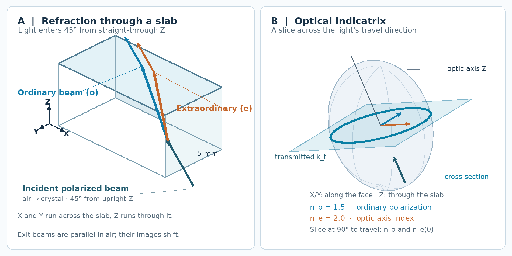
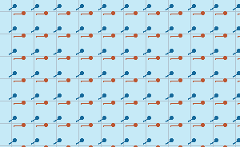
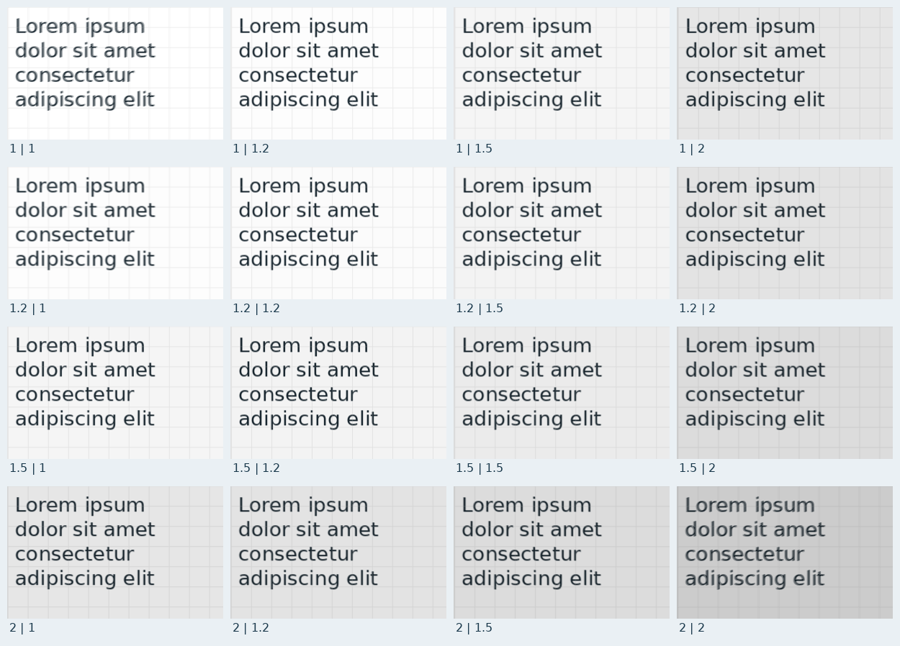
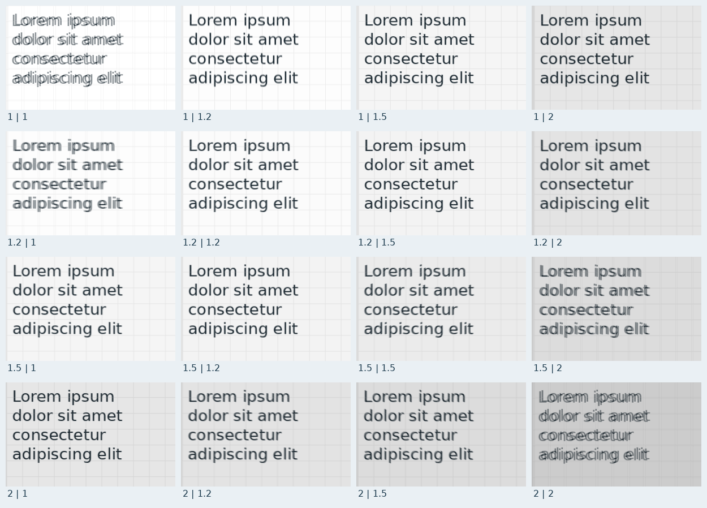
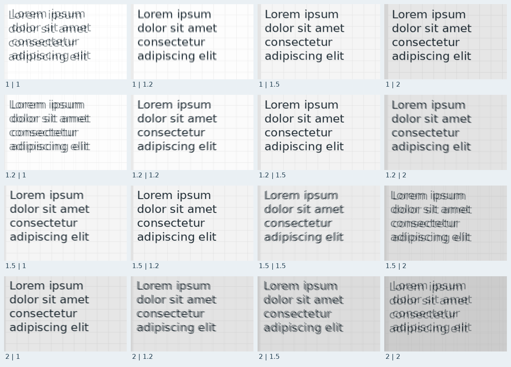
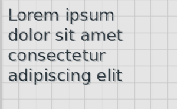

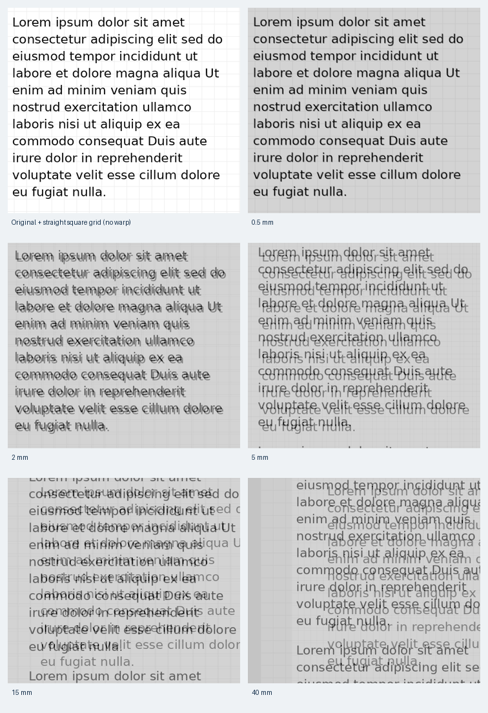

To inspect its two 3×3 affine matrices in millimetres without writing an image, add `--refraction-matrices-mm` to the refraction command. The CLI prints JSON. To show a reference grid in the output, add `--show-grid`.


For PowerShell, put each command on **one line** instead of using the Unix `\` continuation. You can also use the installed command `lorem-warped` in place of `python -m lorem_warped`.

## Droplet distribution

The distribution sets the droplet-centre positions; it does not change the radial warp formula. `random` samples seeded positions, `square` aligns rows and columns, and `triangle` offsets alternate rows to give a hexagonal neighbour pattern. Use `triangle` in CLI and Python; `hex` is not a valid distribution name.

### Mechanism and legibility

Each centre defines a circle of radius `--radius` pixels. Inside it, the field points radially from the centre; its magnitude follows the chosen cosine or parabolic profile and goes to zero outside the circle. Overlapping cosine fields add. The image is sampled at output positions minus the field times `--intensity` (a pixel displacement scale), so visible text moves with the field. Radius changes the affected area; intensity changes movement, not brightness. The parabolic profile rejects overlapping circles. Keep movement and changes across individual letters small when you need readable text.

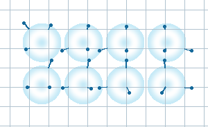

The 4×4 study varies radius and intensity across the labeled rows and columns on the same four-line generated paragraph. Zero-intensity originals display gray droplets at 30% opacity; the guides are not part of the transform. Read along a row to isolate one control and down a column for the other; use the full-size output to judge whether letter shapes remain distinguishable. This is a visual legibility comparison, not a numerical readability or ASD-STE100 certification.

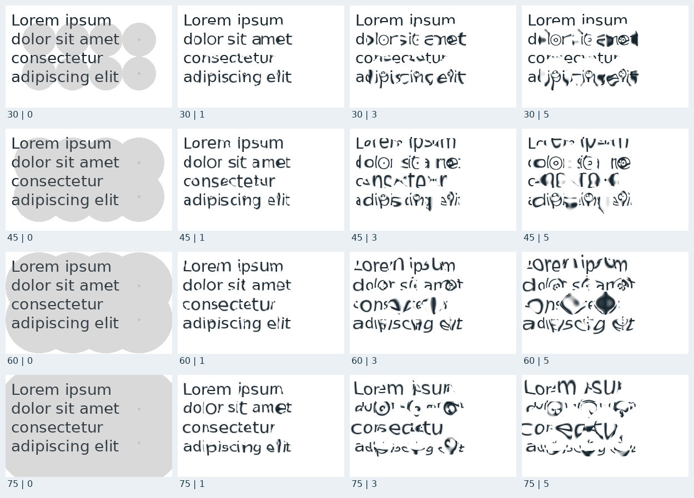

The shaded centre maps mark each centre and its radius-sized area in gray at 30% opacity for the random, square, and triangle distributions. Shading shows the *selected regions*, not a mask drawn onto the output text; intersections indicate where cosine fields can add. Overlapping gray circles keep the same opacity. A requested regular-grid count can be smaller at image boundaries.

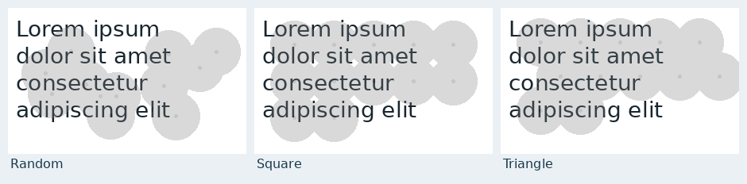

Each row below pairs an unwarped original (left) with its droplet warp (right). The original shows the actual arrangement's droplets as gray regions at 30% opacity; the guide is display-only. All three warped panels use intensity **3 px**, and request 71 centres, radius 50 pixels, seed 7, and the cosine profile. Only the distribution changes between rows. On other page sizes, a shifted triangle row can leave some requested centres outside the page.

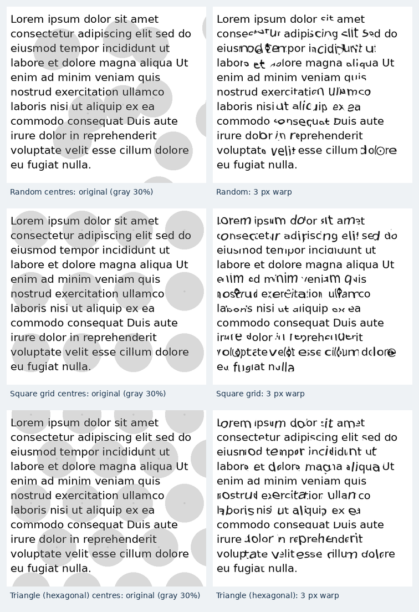

Run each command from the repository root. Each writes a different image. On PowerShell, put each command on one line.

### CLI

```bash
python -m lorem_warped --input original.png \
  --output droplets_random.png --centres 71 --distribution random \
  --radius 50 --intensity 3 --seed 7 --profile cosine
python -m lorem_warped --input original.png \
  --output droplets_square.png --centres 71 --distribution square \
  --radius 50 --intensity 3 --seed 7 --profile cosine
python -m lorem_warped --input original.png \
  --output droplets_triangle.png --centres 71 --distribution triangle \
  --radius 50 --intensity 3 --seed 7 --profile cosine
```

Save this example as `distribution_examples.py` in the repository root, then run `python distribution_examples.py`. Each transform starts with the original image.

### in script

```python
from PIL import Image
from lorem_warped import (
    CentreDistribution, DistortionConfig, WarpTransform, image_to_tensor,
)

with Image.open("original.png") as file:
    source = image_to_tensor(file)

for name in ("random", "square", "triangle"):
    config = DistortionConfig(
        centre_count=71, distribution=CentreDistribution(name),
        radius=50, intensity=3, seed=7, profile="cosine",
    )
    result = WarpTransform(mode="droplet", config=config)(source)
    pixels = result.mul(255).round().byte().permute(1, 2, 0).cpu().numpy()
    Image.fromarray(pixels).save(f"droplets_{name}.png")
```

The example uses overlapping cosine-profile circles. For disjoint parabolic circles, use `--nonoverlapping-page --profile parabolic` in the CLI. The page-wide layout overrides `--centres`; it does not reproduce the paired comparison above.

## 3. Run all three in a Python script

The ready-to-run file `examples/three_transforms.py` applies each transform to a fresh view of the same input:

### CLI

```bash
python examples/three_transforms.py --input original.png --output-dir examples/output
```

It writes `droplet.png`, `sine_lens.png`, and `refractive_index.png` into that directory. It does not chain the effects. For your own script, use this pattern:

### in script

```python
import numpy as np
from PIL import Image
from lorem_warped import DistortionConfig, WarpTransform, image_to_tensor

with Image.open("original.png") as source:
    image = image_to_tensor(source)  # float RGB CHW, 0..1

transforms = {
    "droplet": WarpTransform(
        mode="droplet",
        config=DistortionConfig(centre_count=3, distribution="random",
                                radius=80, intensity=5, seed=7, profile="cosine"),
    ),
    "sine_lens": WarpTransform(
        mode="sine_lens", intensity=32,
        lens_options={"frequency_x": 2.5, "frequency_y": 1.5,
                      "phase_x": 0.1, "phase_y": 0.2,
                      "amplitude_x": 1.2, "amplitude_y": 0.8},
    ),
    "refractive_index": WarpTransform(
        mode="refractive_index",
        refraction_options={"thickness_mm": 5, "n_x": 1.3, "n_y": 2.5,
                            "n_z": 1.3, "polarization_deg": 45,
                            "direction_xyz": (-1, 1, 1),
                            "page_width_mm": 210, "page_height_mm": 297},
    ),
}
for name, transform in transforms.items():
    output = transform(image)
    pixels = output.mul(255).round().byte().permute(1, 2, 0).cpu().numpy()
    Image.fromarray(np.asarray(pixels)).save(f"{name}.png")
```

To run a transform on CUDA, use `image = image.to("cuda")` after loading and before calling the transform (you need a compatible PyTorch build and GPU). The returned tensor stays on that device; `.cpu()` is necessary before conversion to a NumPy array. These transforms are for one CHW image at a time, not an NCHW batch. For a training pipeline, instantiate the `WarpTransform` once and call it for each image. The sampler uses `grid_sample` with bilinear sampling, border padding, and aligned corners. Extreme displacement can fold text or make repeated/border-clamped pixels. Check the output at full size.

## 4. Strength sweep and PDF manual

The [illustrated operator manual](docs/lorem-warped-manual.pdf) gives CLI and Python-script examples for every built-in transform: droplets, sine lens, refractive index, horizontal wave, vertical wave, and gentle pinch. It also shows the API-only custom mode. It opens with a package introduction, installation guide, and miniature distortion tree. Each transform chapter gives a measured field plot beside a distorted paragraph, a one-page 2×3 strength comparison, and a 4×4 legibility study. The droplet chapter includes shaded centre maps; non-droplet galleries and studies show a square grid transformed with the text. Their studies use larger settings so the movement is visible. Geometric modes vary pixel intensity; the refractive mode varies slab thickness in millimetres. The sine-lens six shape parameters stay fixed at pixel intensities **0.5, 4, 32, 256, and 1024** in its strength comparison. Its source is `docs/build_manual.py` and `docs/manual_atlas.py`. To regenerate the PDF and the images from `original.png`:

### CLI

```bash
python -m pip install -e '.[dev]'
python docs/build_manual.py --input original.png --output docs/lorem-warped-manual.pdf
```

The full generated PNG files and `manual-manifest.json` go in `docs/generated/` (not tracked). README figures live in `docs/images/`; the PDF embeds individual panels. The manual uses short, direct instructions inspired by ASD-STE100 Simplified Technical English. Neither the manual nor these visual studies claim formal ASD-STE100 conformity.

## 5. Verify and troubleshoot

### CLI

```bash
python -m pip install -e '.[dev]'
python -m pytest -q
python -m lorem_warped --help
```

- `ModuleNotFoundError`: activate the environment that has the editable installation. Reinstall with `python -m pip install -e .` if necessary.
- `FileNotFoundError`: run in the repository root or use an absolute `--input` path.
- CUDA error: check your GPU and PyTorch build with the official installer selector; use CPU until the GPU install works.
- Unreadable large warp: decrease geometric `--intensity`; it is not a brightness control or a refractive thickness.
- Invalid lens control: use finite phase and amplitude values, and positive finite frequencies.
- Invalid slab geometry: use nonnegative thickness, positive refractive indices and page sizes, and a positive Z direction.

## Public API and other modes

The package exports `WarpTransform`, `DistortionConfig`, `CentreDistribution`, `distort_image`, `displacement_field`, `warp_page`, `page_warp_field`, `warp_image`, `sine_lens`, `horizontal_wave`, `vertical_wave`, `gentle_pinch`, `PAGE_WARPS`, `refract_image`, `refractive_index_field`, `refraction_distortion_matrices`, `image_to_tensor`, `render_lorem_page`, `overlay_warped_grid`, `make_centres`, `make_page_centres`, `make_nonoverlapping_centres`, `validate_nonoverlap`, and `parabolic_profile`. Page functions take normalized `(y, x)` tensors and return a `(dy, dx)` field. `warp_image` samples the input at output coordinates minus `intensity × field`. Positive displacement moves visible content down or right. Other CLI page modes are `horizontal_wave`, `vertical_wave`, and `gentle_pinch`; use `--page-warp NAME --intensity PIXELS`. `WarpTransform` defaults to droplet mode; its page-mode default intensity is 3 pixels, while the CLI page-mode default is 12 pixels. Set the intensity explicitly if you compare the two interfaces.


### Horizontal wave

This field moves text left/right in three broad bands down the page. A smooth envelope holds the page edges fixed. The function figure shows the horizontal component; the 4×4 study varies wave cycles and intensity through a Python-only parameterized callback, while the reference grid reveals sideways displacement. The built-in waveform has fixed cycles; `--intensity` scales its pixel movement. The study does not change the original text or add a CLI cycle flag.

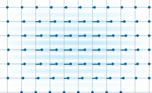
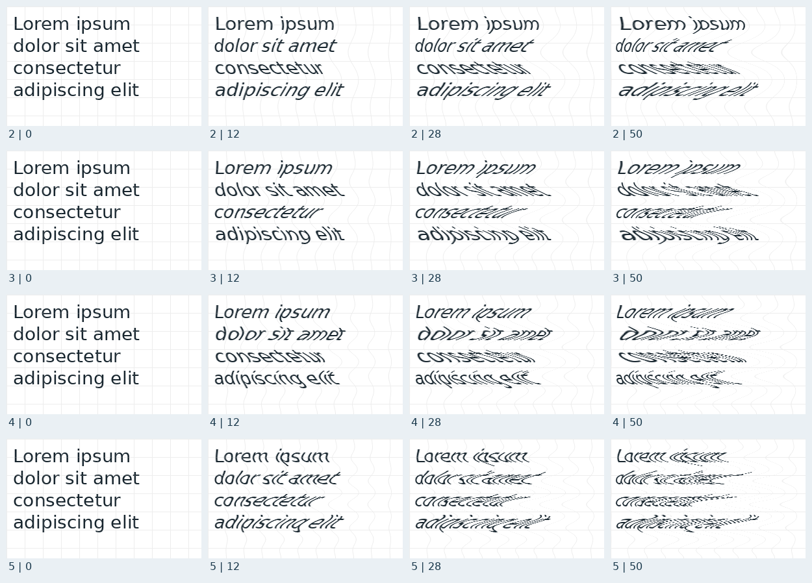
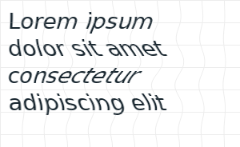

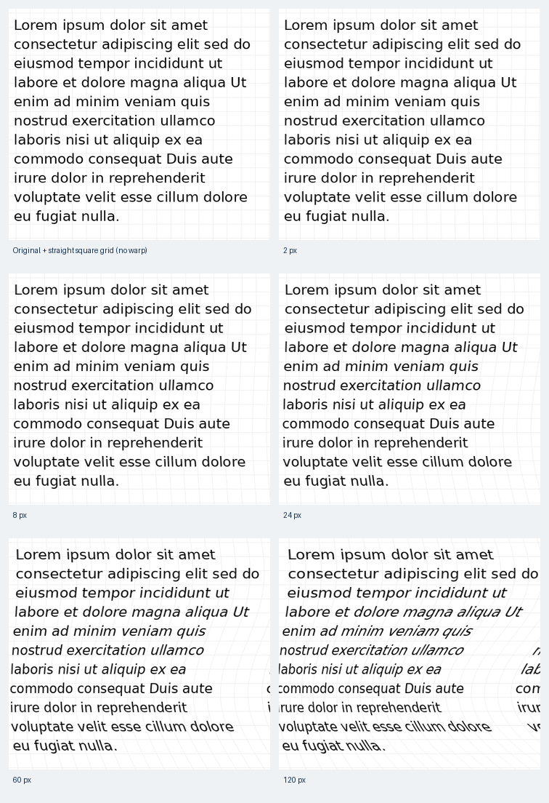

#### CLI

`python -m lorem_warped --input original.png --output horizontal_wave.png --page-warp horizontal_wave --intensity 60`

#### in script

`WarpTransform(mode="horizontal_wave", intensity=60)(image)`

### Vertical wave

This field bows baselines up/down in two broad waves across the page; its envelope holds the edges fixed. The function figure shows vertical displacement; the 4×4 study varies cycles and intensity through a Python-only parameterized callback, with the original text unchanged. The built-in waveform has fixed cycles; `--intensity` sets its pixel displacement. The study does not add a CLI cycle flag.

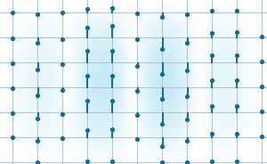
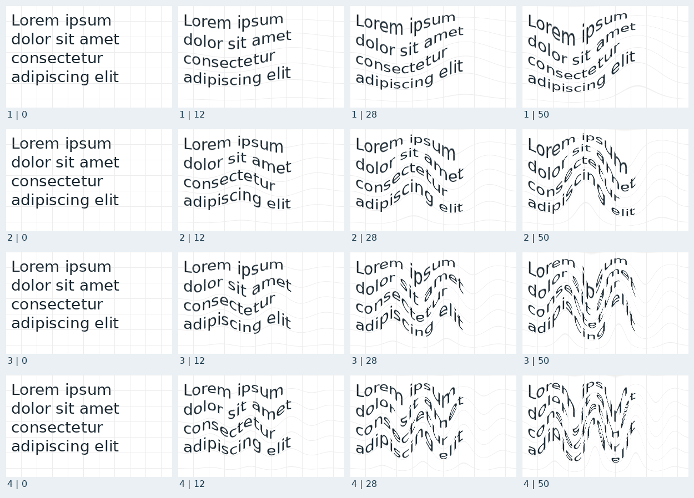
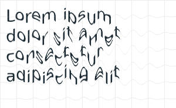

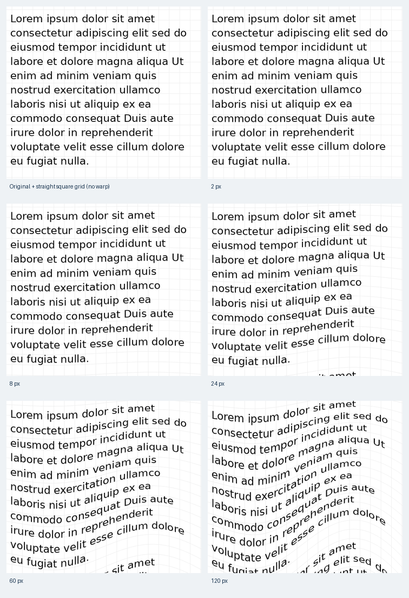

#### CLI

`python -m lorem_warped --input original.png --output vertical_wave.png --page-warp vertical_wave --intensity 60`

#### in script

`WarpTransform(mode="vertical_wave", intensity=60)(image)`

### Gentle pinch

This field moves text toward the page centre, with displacement tapered to zero at all four edges. The function figure shows inward vectors; the 4×4 study varies the envelope power and intensity through a Python-only parameterized callback, with the original text unchanged. The built-in pinch has fixed envelope power; `--intensity` is its pixel control. The study does not add a CLI envelope-power flag.

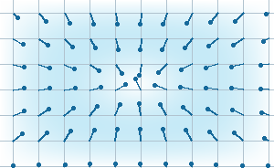
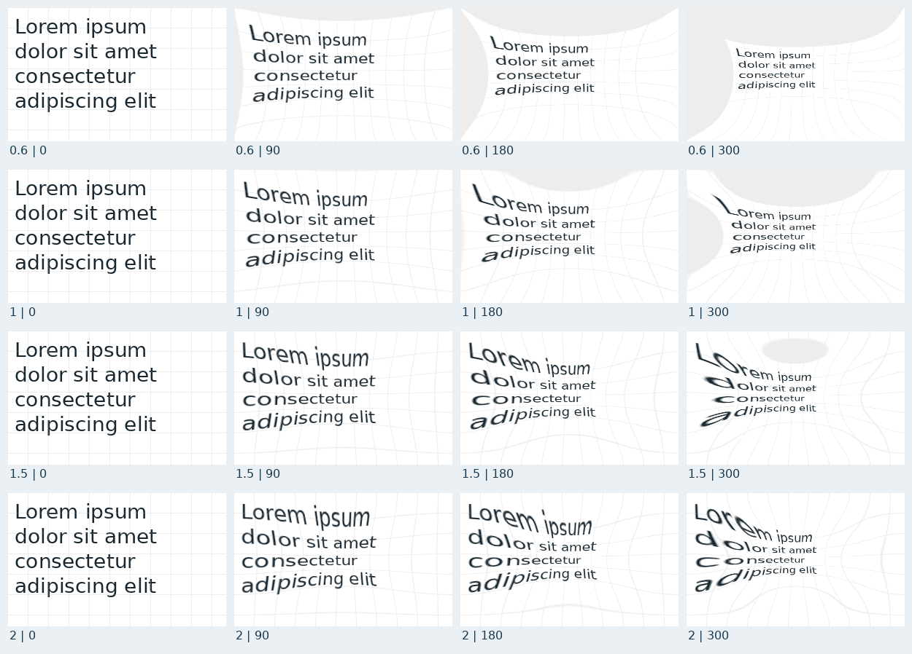
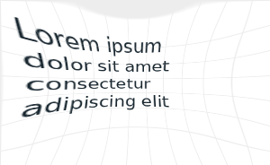

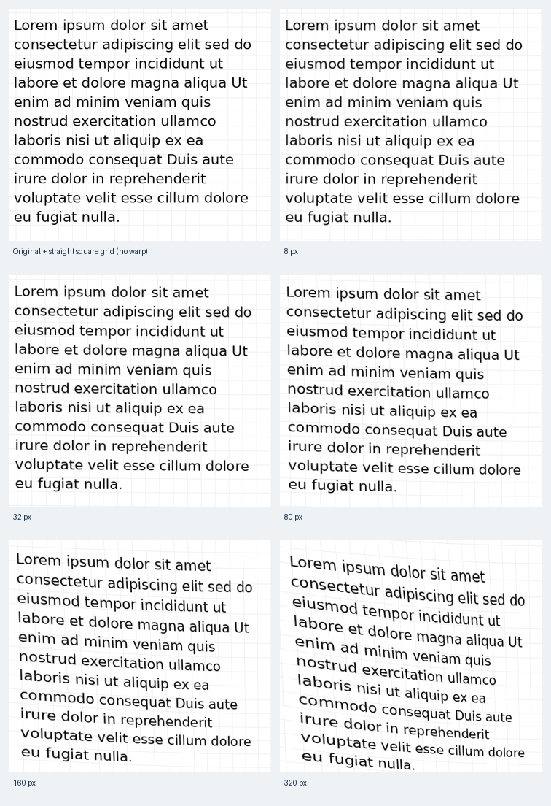

#### CLI

`python -m lorem_warped --input original.png --output gentle_pinch.png --page-warp gentle_pinch --intensity 160`

#### in script

`WarpTransform(mode="gentle_pinch", intensity=160)(image)`

### Custom warp (Python only)

The `custom` mode takes a function of normalized `(y, x)` tensors. It returns `(dy, dx)` tensors.

The custom callback uses a sine envelope at the edges and independently adjustable X and Y wave cycles. It returns both vertical and horizontal displacement. The gallery shows 5, 10, and 20 px intensity with both cycle counts held at 2, alongside other strengths. Three labeled 4×4 studies hold intensity at 5, 10, or 20 px and vary X cycles (rows) and Y cycles (columns) through 1, 2, 3, 4. The original text and source grid stay fixed; only transform parameters change. There is no CLI callback interface.

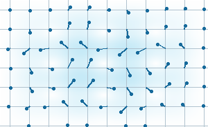
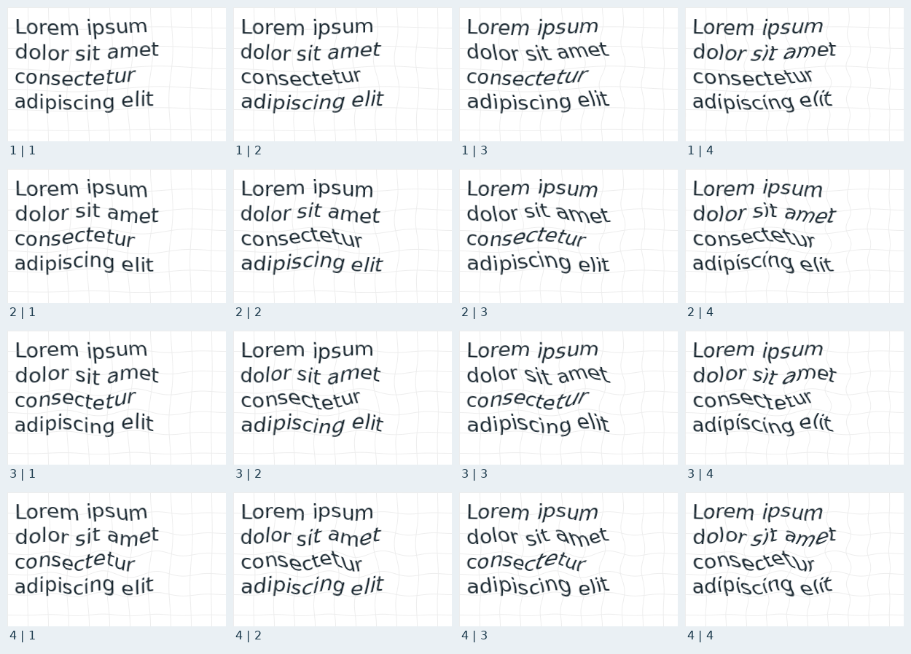
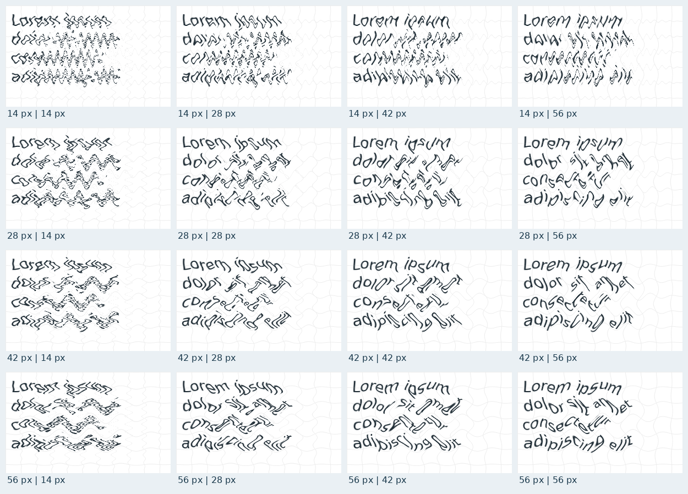
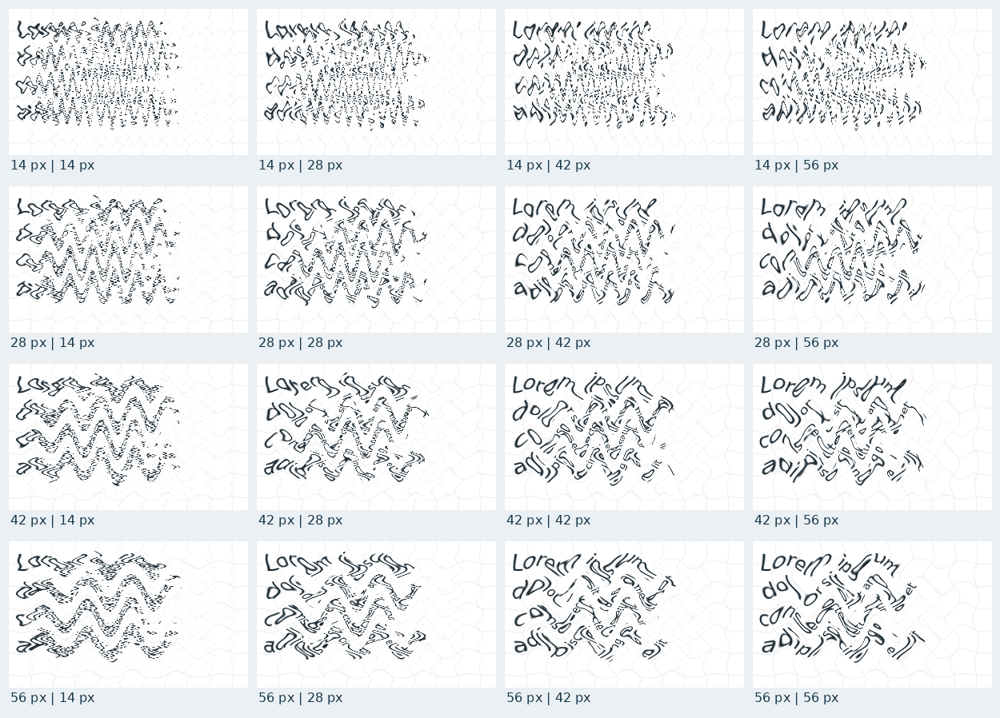


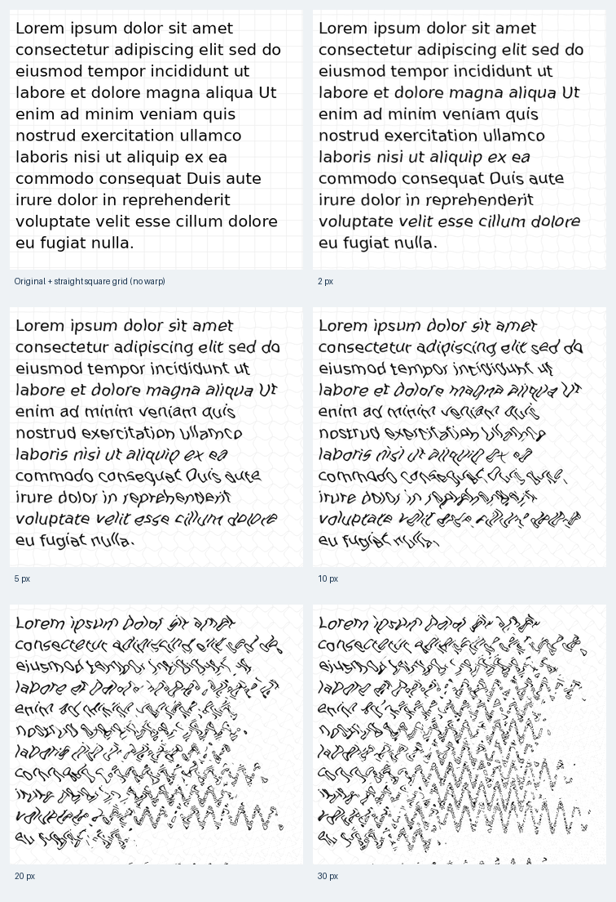

#### CLI

Not available. The CLI does not accept arbitrary Python callbacks.

#### in script

```python
import math
import torch
from PIL import Image
from lorem_warped import WarpTransform

def custom_wave(cycles_x, cycles_y):
    def field(y, x):
        edge = torch.sin(math.pi * y) * torch.sin(math.pi * x)
        return (edge * torch.sin(2 * math.pi * cycles_x * x),
                edge * torch.sin(2 * math.pi * cycles_y * y))
    return field

for strength in (5, 10, 20):
    for cycles_x in (1, 2, 3, 4):
        for cycles_y in (1, 2, 3, 4):
            result = WarpTransform(
                mode="custom", intensity=strength,
                warp_function=custom_wave(cycles_x, cycles_y),
            )(image)
            pixels = result.mul(255).round().byte().permute(1, 2, 0).cpu().numpy()
            Image.fromarray(pixels).save(
                f"custom_{strength}px_x{cycles_x}_y{cycles_y}.png")
```
