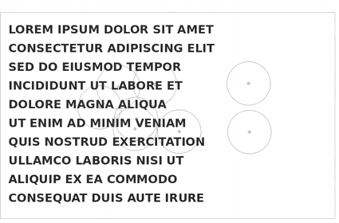
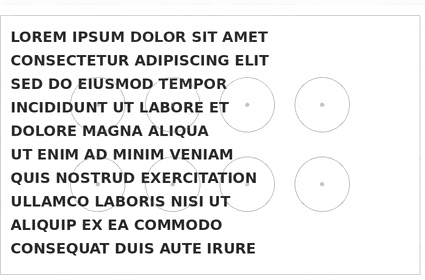
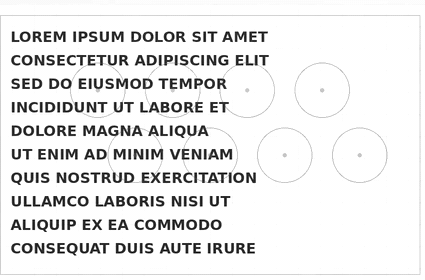
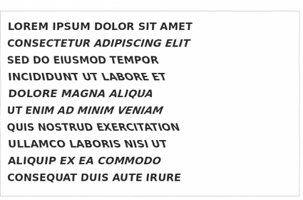
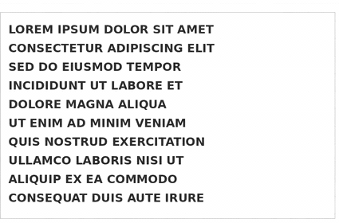

# lorem-warped

Controlled, repeatable image distortion for text-page examples and experiments. `lorem-warped` provides PyTorch transforms and a command-line tool: choose a field, set its strength, and apply it to an image. Fixed inputs and settings reproduce the same result; set a seed when placing random droplets. The examples below start from the bundled `original.png`.

## Download and run locally

Requires Python 3.10+. From a terminal:

```bash
git clone https://github.com/Arghantyr/lorem-warped.git
cd lorem-warped
python -m venv .venv
source .venv/bin/activate          # Windows PowerShell: .venv\Scripts\Activate.ps1
python -m pip install -e .
python -m lorem_warped --help
```

Make a local image (do not overwrite the input):

```bash
python -m lorem_warped --input original.png --output droplet.png \
  --centres 3 --distribution random --radius 80 --intensity 5 --seed 7
```

For a page-wide effect, replace the droplet options with `--page-warp horizontal_wave --intensity 60` and change the output filename. Other page modes are listed below. Omit `--input` to use a generated Lorem ipsum page. On PowerShell, enter each multiline command on one line.

In Python, the input and result are single CHW tensors (channels × height × width), with float pixels in `[0, 1]`:

```python
from PIL import Image
from lorem_warped import WarpTransform, image_to_tensor

image = image_to_tensor(Image.open("original.png"))
result = WarpTransform(mode="horizontal_wave", intensity=60)(image)
pixels = result.mul(255).round().byte().permute(1, 2, 0).cpu().numpy()
Image.fromarray(pixels).save("horizontal_wave.png")
```

## Transformations and their extent

The animations illustrate the visual behavior, not the exact parameters of the commands above. Geometric `--intensity` is a nonnegative pixel-displacement scale, not a brightness setting or a fixed maximum; high values can make text unreadable.

| Local and lens effects | Page-wide effects |
| --- | --- |
| **Droplets** — circular local displacement. Choose `random`, `square`, or `triangle` centre layouts; `--centres` requests their count, `--radius` sets the affected area in pixels, and `--intensity` scales movement. `--seed` fixes random placement. `--profile cosine` allows overlap; `parabolic` requires disjoint circles.<br>Previews: random, square, triangle (left to right).<br> | **Horizontal wave** — three broad left/right bands, tapered at the edges.<br> |
| **Sine lens** — repeated lens-like cells across the page. `--lens-a`/`--lens-b` set positive integer X/Y counts (default 2 each); `--lens-frequency-x/y` accept positive fractional counts instead. `--lens-phase-x/y` shift by fractions of a cycle; `--lens-amplitude-x/y` set signed axis gains. `--intensity` scales final movement.<br> | **Vertical wave** — two broad up/down baseline bends, tapered at the edges.<br> |
| **Refractive slab** — two constant-offset polarization views through a uniform slab; it does **not** bend the page spatially. Set nonnegative `--refraction-thickness-mm`, positive `--refraction-n-x/y/z`, polarization angle, ray direction, and physical page width/height (default 210 × 297 mm). Do not use geometric `--intensity` for this mode.<br> | **Gentle pinch** — smooth inward movement toward the centre, fading at the edges.<br> |
| **Custom (Python only)** — supply a function of normalized `(y, x)` tensors returning `(dy, dx)` fields; `WarpTransform(mode="custom", warp_function=field, intensity=10)` applies it. No custom-function CLI flag exists.<br> | For the three built-in page modes at right, use `--page-warp horizontal_wave`, `vertical_wave`, or `gentle_pinch` and a nonnegative `--intensity`. |

For the physical slab, try `python -m lorem_warped --input original.png --output slab.png --page-warp refractive_index --refraction-thickness-mm 5 --refraction-n-x 1.3 --refraction-n-y 2.5`. For more settings and illustrated strength comparisons, see the [operator manual](docs/lorem-warped-manual.pdf).
