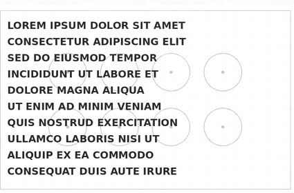
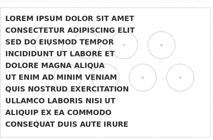
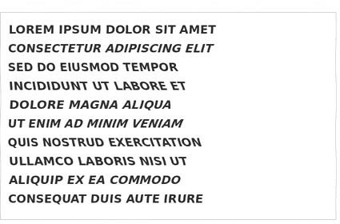
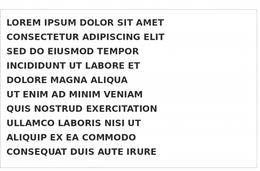
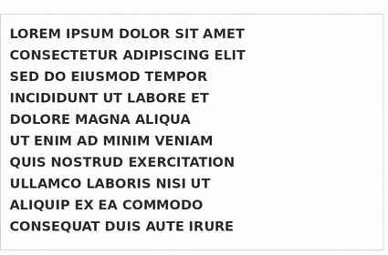

# lorem-warped

Controlled, repeatable image distortion for text-page examples and experiments. `lorem-warped` provides PyTorch transforms and a command-line tool: choose a field, set its strength, and apply it to an image. Fixed inputs and settings reproduce the same result; set a seed when placing random droplets. The examples below start from the bundled `original.png`.

## Download and run locally

Requires Python 3.10+. From a terminal:

```bash
git clone https://github.com/Arghantyr/lorem-warped.git
cd lorem-warped
python -m venv .venv
source .venv/bin/activate          # Windows PowerShell: .venv\Scripts\Activate.ps1
python -m pip install -e .
python -m src --help
```

Make a local image (do not overwrite the input):

```bash
python -m src --input original.png --output droplet.png \
  --centres 3 --distribution random --radius 80 --intensity 5 --seed 7
```

For page waves, set a positive `--wavelength` in pixels as well as the pixel-displacement `--intensity`. Horizontal waves repeat along Y and move text left/right; vertical waves repeat along X and move text up/down. If you omit wavelength, the original three-cycle horizontal or two-cycle vertical preset remains available. Omit `--input` to use a generated Lorem ipsum page. On PowerShell, enter each multiline command on one line.

```bash
python -m src --input original.png --output horizontal_wave.png --page-warp horizontal_wave --wavelength 28 --intensity 20
python -m src --input original.png --output vertical_wave.png --page-warp vertical_wave --wavelength 28 --intensity 20
```

Page waves have `edge_taper=True` by default: with zero shifts, every boundary pixel has zero wave displacement. Disable the envelope with `--no-edge-taper`. Use `--shift-X` (right) and `--shift-Y` (down) for signed pixel translations. Either nonzero shift overrides edge tapering, including an explicit `--edge-taper`. Translation is in pixels independent of intensity. These options apply to geometric page warps, not droplets or physical refraction.

```bash
python -m src --input original.png --output shifted-x.png --page-warp horizontal_wave --wavelength 28 --intensity 20 --shift-X 18
python -m src --input original.png --output shifted-y.png --page-warp horizontal_wave --wavelength 28 --intensity 20 --shift-Y 12
python -m src --input original.png --output shifted-xy.png --page-warp horizontal_wave --wavelength 28 --intensity 20 --shift-X 18 --shift-Y 12
```

The [operator manual](docs/lorem-warped-manual.pdf) compares the tapered, X-shifted, Y-shifted, and XY-shifted results on the same input.

In Python, the input and result are single CHW tensors (channels × height × width), with float pixels in `[0, 1]`:

```python
from PIL import Image
from src import WarpTransform, image_to_tensor

image = image_to_tensor(Image.open("original.png"))
result = WarpTransform(mode="horizontal_wave", wavelength=28, intensity=20)(image)
pixels = result.mul(255).round().byte().permute(1, 2, 0).cpu().numpy()
Image.fromarray(pixels).save("horizontal_wave.png")
result = WarpTransform(mode="vertical_wave", wavelength=28, intensity=20)(image)
pixels = result.mul(255).round().byte().permute(1, 2, 0).cpu().numpy()
Image.fromarray(pixels).save("vertical_wave.png")
```

### Wavelength and intensity studies

The body text in `original.png` uses a 28px font. Its 50%, 100%, 150%, 200%, and 250% wavelengths are **14, 28, 42, 56, 70 px**. The independent intensity values are **10, 20, 30, 40, 50 px**. Every pair uses the same source pixels. Generate the two built-in wave grids and three custom-wave grids with:

```bash
python -m src.wave_samples --input original.png --font-size-px 28
python -m src.wave_samples --custom-wave --input original.png --font-size-px 28
```

The labeled contact sheets, full-size samples, and exact parameter manifests are in `examples/wave-wavelength-grid/` and `examples/custom-wave-wavelength-grid/`.

| Built-in waves | Custom waves |
| --- | --- |
| [Horizontal 5×5 grid](examples/wave-wavelength-grid/horizontal_wave_grid.png) | [Fixed vertical 5×5 grid](examples/custom-wave-wavelength-grid/custom_wave_fixed_vertical_grid.png) |
| [Vertical 5×5 grid](examples/wave-wavelength-grid/vertical_wave_grid.png) | [Fixed horizontal 5×5 grid](examples/custom-wave-wavelength-grid/custom_wave_fixed_horizontal_grid.png) |
| | [Symmetric X=Y 5×5 grid](examples/custom-wave-wavelength-grid/custom_wave_symmetric_grid.png) |

The custom wave combines vertical and horizontal displacement. `fixed_axis="vertical"` fixes the vertical-wave period to 25% of image width (300px) and uses the chosen wavelength along Y; `fixed_axis="horizontal"` fixes the horizontal-wave period to 25% of image height (400px) and uses the chosen wavelength along X. `fixed_axis="symmetric"` uses the same wavelength in pixels for X and Y. These are Python-only callbacks:

```python
from functools import partial
from src import custom_wave

for variant in ("vertical", "horizontal", "symmetric"):
    field = partial(custom_wave, wavelength=28, fixed_axis=variant)
    result = WarpTransform(mode="custom", intensity=20, warp_function=field)(image)
    pixels = result.mul(255).round().byte().permute(1, 2, 0).cpu().numpy()
    Image.fromarray(pixels).save(f"custom_wave_{variant}.png")
```

## Mask the displacement

Use `--mask` to control where a warp acts. The mask must have the same width and height as the input image. Black disables displacement, white keeps its full strength, and gray gives an intermediate strength. The mask scales the displacement field at output pixel positions before sampling; it does not blend two finished images. RGB mask files are converted to grayscale. Try the bundled left-to-right gradient, sized for `original.png`:

```bash
python -m src --input original.png --mask src/mask-gradient.png \
  --page-warp sine_lens --intensity 32 --output masked.png
```

In Python, pass a mask path or a normalized H×W tensor with values in `[0, 1]`:

```python
from pathlib import Path

result = WarpTransform(mode="sine_lens", intensity=32,
                       mask=Path("src/mask-gradient.png"))(image)
```

Masking also works with droplet and refractive-index modes, and with the `mask` argument to `warp_image`, `warp_page`, `distort_image`, and `refract_image`. In refraction, the two displacement fields are masked separately; a black mask does not remove the model's transmission/brightness effect. Invalid values or dimensions raise an error rather than resizing the mask. Omit the mask for an unmasked warp.

## Logical image masks

`ImageTransform` applies a pixelwise logical `and`, `or`, or `xor` to an image and a same-size **binary** mask, rather than masking the warp's displacement. White mask pixels are `1`, black pixels are `0`. XOR flips black and white where the mask is white; AND keeps white pixels only where both image and mask are white; OR makes pixels white where either is white.

```python
import torch
from src import ImageTransform, WarpTransform

mask = torch.zeros(image.shape[1:], dtype=torch.bool)  # H×W, black by default
mask[:, image.shape[2] // 2:] = True  # invert the right half
result = ImageTransform(operation="xor", mask=mask)(image)
warped = WarpTransform(mode="horizontal_wave", intensity=20)(image)
result = ImageTransform.logical_xor(warped, mask)  # image or transformed image first, mask second
```

The callable also accepts a path to a binary mask image. Inputs are CHW tensors (float `[0, 1]`, 8-bit integer, or bool); image values at least `0.5` are treated as white, so gray anti-aliased/warped pixels become black or white. Results are new float CHW tensors with values `0` or `1`. Gray masks are rejected; logical operations are not differentiable. This is a Python API feature, not a CLI `--mask` option.

To see XOR on text, generate ten checkerboards with square sides geometrically spaced from 4× to ¼× the original page's nominal 28px body font height (112, 82, 60, 44, 33, 24, 18, 13, 10, 7px):

```bash
python -m src.checkerboard_samples --input original.png \
  --crop 70 104 590 564 --output-dir examples/checkerboard-xor
```

The [contact sheet](examples/checkerboard-xor/contact_sheet.png) compares the source, binary mask, and XOR result at every size; `manifest.json` lists the ten full-resolution mask/result pairs. Use `--font-height-px` and `--crop` for a different known-font image, or omit `--crop` to use the full image.

## Transformations and their extent

The animations are cropped from `lorem-warped-motion-v7.mp4` to show only its white image panel. They illustrate the visual behavior, not the exact parameters of the commands above. Geometric `--intensity` is a nonnegative pixel-displacement scale, not a brightness setting or a fixed maximum; high values can make text unreadable.

| Local and lens effects | Page-wide effects |
| --- | --- |
| **Droplets** — circular local displacement. Choose `random`, `square`, or `triangle` centre layouts; `--centres` requests their count, `--radius` sets the affected area in pixels, and `--intensity` scales movement. `--seed` fixes random placement. `--profile cosine` allows overlap; `parabolic` requires disjoint circles.<br>Previews: random, square, triangle (left to right).<br> | **Horizontal wave** — left/right movement varying along Y. `--wavelength` gives its vertical period in pixels; omitted means the legacy three-cycle pattern. Edges stay pinned.<br> |
| **Sine lens** — repeated lens-like cells across the page. `--lens-a`/`--lens-b` set positive integer X/Y counts (default 2 each); `--lens-frequency-x/y` accept positive fractional counts instead. `--lens-phase-x/y` shift by fractions of a cycle; `--lens-amplitude-x/y` set signed axis gains. `--intensity` scales final movement.<br> | **Vertical wave** — up/down movement varying along X. `--wavelength` gives its horizontal period in pixels; omitted means the legacy two-cycle pattern.<br> |
| **Refractive slab** — two constant-offset polarization views through a uniform slab; it does **not** bend the page spatially. Set nonnegative `--refraction-thickness-mm`, positive `--refraction-n-x/y/z`, polarization angle, ray direction, and physical page width/height (default 210 × 297 mm). Do not use geometric `--intensity` for this mode.<br> | **Gentle pinch** — smooth inward movement toward the centre, fading at the edges.<br> |
| **Custom wave (Python only)** — use `custom_wave(y, x, wavelength=28, fixed_axis="vertical")` as the `warp_function` in `WarpTransform(mode="custom", intensity=20, ...)`. The fixed variants use 25% of image width/height for one period; symmetric uses the chosen period on both axes. No custom-function CLI flag exists.<br> | For the three built-in page modes at right, use `--page-warp horizontal_wave`, `vertical_wave`, or `gentle_pinch` and a nonnegative `--intensity`. |

For the physical slab, try `python -m src --input original.png --output slab.png --page-warp refractive_index --refraction-thickness-mm 5 --refraction-n-x 1.3 --refraction-n-y 2.5`. For more settings and illustrated strength comparisons, see the [operator manual](docs/lorem-warped-manual.pdf).

## Image Transform

The `ImageTransform` class operates on image pixels. It does not move pixels like `WarpTransform`, and its binary mask is different from the displacement mask described above. Select `and`, `or`, or `xor` in Python; the [Python API reference](docs/API_REFERENCE.md) describes all three.

### XOR

White squares invert the source's black-and-white pixels; black squares leave them unchanged. `ImageTransform.logical_xor(image, mask)` accepts a CHW image tensor (including a `WarpTransform` result) and a same-size H×W binary mask tensor or mask-file path. Gray image pixels are thresholded at 0.5, so the result is binary. For the nominal 28px body font, the PDF's illustrated checkerboards are examples 02–07: 82, 60, 44, 33, 24, and 18px squares. The [operator manual](docs/lorem-warped-manual.pdf) pairs each saved mask with its actual XOR result. Regenerate all ten examples with the command in “Logical image masks” above.
